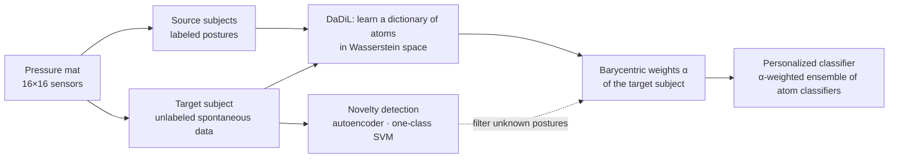

# Smart Chair: Personalized Posture Classification with Domain Adaptation

> CentraleSupélec · AI & ML track · Client: **CEA-List** (French national research lab) · Feb – Jun 2024 · Team of 5

**TL;DR**: A 16×16 pressure-sensing mat is meant to recognize 7 sitting postures. The difficulty is that every person's body shape shifts the data, so a classifier trained on some people fails on a new one. We applied **multi-source domain adaptation with optimal transport** (DaDiL) to build a personalized classifier for an unseen user without any of their labels. We then **diagnosed why it broke on real-world data**: spontaneous sitting contains many postures outside the 7 known ones. To address this, we built **novelty-detection** components that flag those postures.

> ℹ️ Code is kept in a private team repository; the recordings are the lab's data.

---

## Context

Prolonged sitting and poor posture are a major workplace health issue. CEA-List researches **dictionary learning for domain adaptation** and wanted to test its methods on real sensor data instead of synthetic data.

## Data

- **Sensor:** a 16×16 pressure mat (256 sensors) that can be placed on any seat
- **7 controlled postures:**
  1. correct posture
  2. leaning forward, feet on the ground
  3. leaning back, right leg crossed
  4. leaning back, left leg crossed
  5. leaning forward, right leg crossed
  6. leaning forward, left leg crossed
  7. leaning back against the backrest
- **Two regimes per subject:**
  - *controlled* data, where the posture is imposed and labeled;
  - *spontaneous* data, where the subject sits freely and nothing is labeled.
- **Subjects:** 6, including **2 recorded by our team** with a longer protocol of several minutes per posture. That gave ~4k samples per class, versus ~30–150 in earlier recordings.

## Approach

1. **Exploration.** We built pressure heatmaps and projected the data with PCA, UMAP and t-SNE. Postures form clear clusters *within* a subject, but the shift *between* subjects is strong. That shift is exactly what domain adaptation is meant to handle.
2. **Domain adaptation with DaDiL-E** ([Montesuma, Ngolè Mboula & Souloumiac, 2023](https://arxiv.org/abs/2307.14953)).
   - Each subject is treated as a domain.
   - We learn a dictionary of 5 "atom" distributions with optimal transport, so that every subject is a Wasserstein barycenter of the atoms.
   - The new user's classifier is the α-weighted ensemble of classifiers fitted on each atom. We tested SVM, gradient boosting, random forest and logistic regression as base classifiers.
3. **Diagnosis.** On the target subject's controlled data, the personalized classifier reached only **12–28% accuracy** (7 classes, chance ≈ 14%). The cause: the target's spontaneous data is dominated by **postures that belong to none of the 7 classes**, and these bias its barycentric weights.
4. **Clustering and distance metrics.** We used k-means and DBSCAN to separate controlled from spontaneous behavior. We found that Euclidean distance is poorly suited to pressure maps: the same posture at a different overall pressure level ends up far away, while two different postures of the same person look close. We designed and tested a **scale-invariant metric** based on vector collinearity. It did not separate postures better, and we documented it as a negative result.
5. **Novelty detection.** We trained a dense **autoencoder** on the known postures. A reconstruction-error (MSE) threshold then flags unseen postures in the spontaneous stream. We also implemented a **one-class SVM** as an alternative boundary-based detector.
6. **Optimal transport exploration.** We experimented with the POT library on synthetic Gaussian distributions to understand transport plans and Wasserstein distances.

## Results

| Component | Outcome |
|---|---|
| DaDiL-E personalized classifier (unseen target subject) | 12–28% accuracy depending on the base learner (random forest best): not usable as is |
| Root-cause analysis | Unknown postures in spontaneous data contaminate the target's barycentric weights |
| Autoencoder novelty detection | Clear separation: known postures concentrate at low reconstruction error, while spontaneous data shows a long tail of high-error samples, which are flagged as novel |
| Custom scale-invariant metric | No improvement over Euclidean distance (negative result) |

**Takeaway:** in this research project, the main value was finding *why* a promising method breaks on real-world data, and building the component needed to fix it (novelty filtering).

## Next steps proposed to the lab

- **Down-weight flagged samples** in the barycentric regression, instead of treating all target samples equally
- **Semi-supervised variant**, using a few labels from the target user
- **Add an explicit "unknown posture" class**, by labeling new spontaneous recordings

## My contribution

- Team role: **client-relationship lead**, keeping the team aligned with the researcher's expectations and maintaining delivery momentum
- [technical contribution to fill in]

## Stack

`Python` · `NumPy` · `scikit-learn` · `POT (Python Optimal Transport)` · `UMAP` · `autoencoders` · `Git` · `LaTeX`

## References

- E. F. Montesuma, F. Ngolè Mboula, A. Souloumiac. *Multi-Source Domain Adaptation through Dataset Dictionary Learning in Wasserstein Space*, ECAI 2023.
- S. Marsland. *Novelty Detection in Learning Systems*, 2003.
